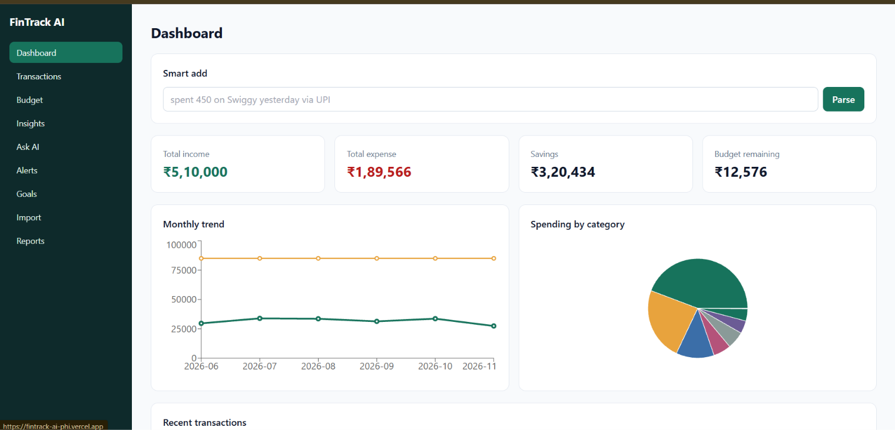
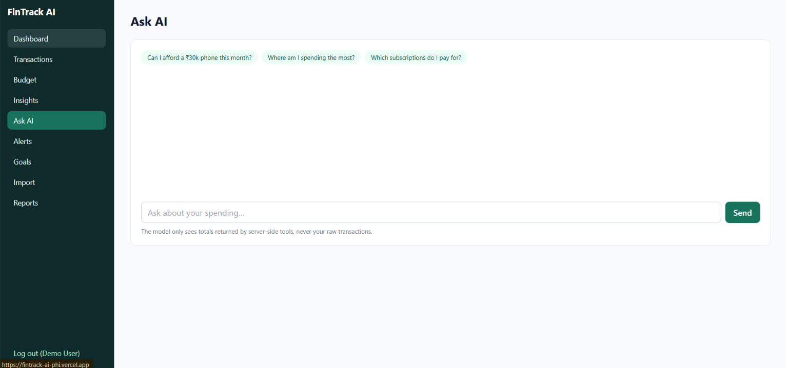
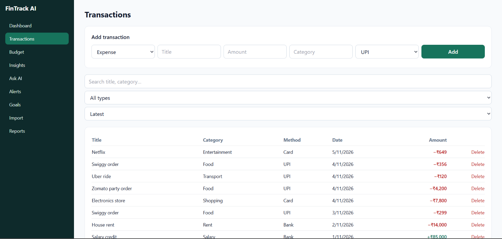
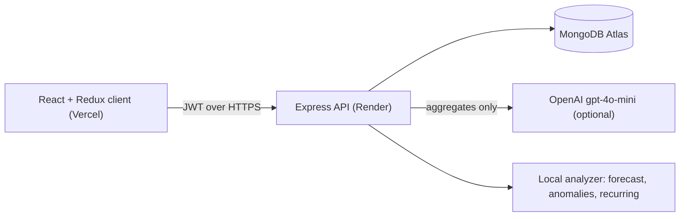

# FinTrack AI

A full-stack personal finance tracker (MERN) that turns raw income and expense entries into budgets, forecasts, alerts and plain-language answers. AI features are an upgrade, not a dependency: every one of them has a local fallback, so the app works with no API key.

**Live demo:** [https://YOUR-APP.vercel.app](https://fintrack-ai-phi.vercel.app/)
**Demo login:** `demo@fintrack.app` / `Demo12345`
(The API runs on a free Render instance, so the first request after a pause can take about a minute.)





## Features

- **Auth:** JWT with bcrypt-hashed passwords, protected routes, automatic logout on 401.
- **Transactions:** add, edit, delete, with search, type filter, sorting and pagination.
- **Budgets:** monthly limit plus per-category limits, progress bars and overspend alerts.
- **Dashboard:** totals, savings, monthly trend, category breakdown, recent activity.
- **Reports:** monthly summary with a PDF export streamed from the server (PDFKit).

### AI features

| Feature | With OpenAI key | Without a key |
|---|---|---|
| **Smart add** ("spent 450 on Swiggy yesterday via UPI") | LLM returns structured JSON, validated with Zod | Regex and keyword parser |
| **Ask AI** chat | Model calls server-side tools and answers from their results | Short spending summary |
| **Insights** | Specific, actionable tips | Rule-based insights |
| **Smart import** (bank CSV) | Unknown merchants categorised in one batched call | Saved rules, then keywords, else "needs review" |

Features that use no LLM at all:

- **Anomaly detection:** per-category outliers using Q3 + 1.5 × IQR.
- **Recurring payments:** same title in 3+ months, similar amounts, roughly monthly gaps.
- **Forecast:** weighted moving average of the last 6 months, with a range and a confidence score that drops when spending is volatile.
- **Goal planner:** how much to save monthly and which flexible categories could absorb the gap.

## Architecture



## Design decisions

- **Deterministic first, AI second.** The analyzer is the source of truth for numbers. The model only explains or extends it, so a failed or missing LLM never breaks a page.
- **The model never sees raw transactions.** In chat it can only call four tools (category totals, monthly trend, budget status, recurring payments) that return aggregates. This limits data leaving the server and stops the model inventing figures.
- **Validate everything the model returns.** LLM output is parsed with Zod before it touches the database or the UI.
- **Learn from corrections.** Fixing a category during import saves a merchant rule, so later imports need fewer AI calls.
- **Protect cost and abuse.** AI routes have a separate, stricter rate limit; AI calls have timeouts and one retry.
- **Per-user isolation.** Every query is scoped by `userId`, including updates and deletes, so a guessed document ID can't touch another user's data.
- **Express 5** handles rejected promises in async handlers, so controllers stay free of try/catch boilerplate.

## Tech stack

- **Client:** React 18, Vite, React Router, Redux Toolkit, Axios, Recharts, Tailwind CSS
- **Server:** Node.js (ES modules), Express 5, Mongoose, Zod, JWT, bcryptjs, Helmet, express-rate-limit, PDFKit, OpenAI SDK
- **Database:** MongoDB Atlas
- **Hosting:** Vercel (client), Render (API)

## API overview

| Area | Endpoints |
|---|---|
| Auth | `POST /api/auth/signup`, `POST /api/auth/login`, `GET /api/auth/me` |
| Transactions | `GET/POST /api/transactions`, `PUT/DELETE /api/transactions/:id` |
| Import | `POST /api/transactions/import/preview`, `POST /api/transactions/import/commit` |
| Budget | `GET/POST/PUT /api/budget` |
| Dashboard and reports | `GET /api/dashboard/summary`, `GET /api/reports/monthly?year=&month=&format=pdf` |
| AI | `POST /api/ai/parse`, `/chat`, `/insights`, `/predict`, `/goal`; `GET /api/ai/anomalies`, `/recurring` |

## Run locally

Prerequisites: Node.js 18+ and a MongoDB Atlas (or local) database.

```bash
# API
cd server
cp .env.example .env        # fill in MONGODB_URI and JWT_SECRET
npm install
npm run seed                # optional: demo user with 6 months of data
npm run dev                 # http://localhost:5000

# Client (new terminal)
cd client
cp .env.example .env
npm install
npm run dev                 # http://localhost:5173
```

`OPENAI_API_KEY` is optional. Tests: `cd server && npm test`.

## Deployment

- **API on Render:** root directory `server`, build `npm install`, start `npm start`. Set `MONGODB_URI`, `JWT_SECRET`, `JWT_EXPIRE`, `FRONTEND_URL` (the Vercel URL) and optionally `OPENAI_API_KEY`.
- **Client on Vercel:** root directory `client`, set `VITE_API_URL=https://YOUR-API.onrender.com/api`. `vercel.json` rewrites routes to the SPA.

## Known limitations and next steps

- Test coverage is limited to the analyzer (anomalies, recurring payments, forecast); controller and UI tests are next.
- The JWT is stored in localStorage; an httpOnly cookie would be safer but needs extra cross-site setup.
- Only auth uses Redux; page data is fetched per page.
- Planned: CI on GitHub Actions, multi-currency support, and receipt scanning.
